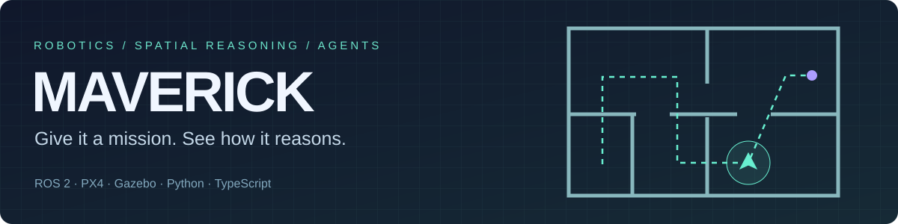
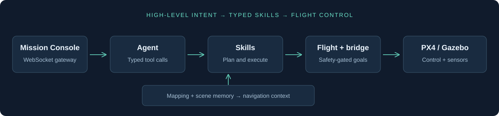

<div align="center">

<picture>
  <source media="(prefers-color-scheme: light)" srcset="assets/banner-light.svg" />
  
</picture>

# Maverick

### Give the drone a mission. See how it thinks.

An indoor-drone autonomy prototype connecting natural-language instructions,<br>spatial memory, navigation and an observable mission console.

**Python · ROS 2 Jazzy · PX4 · Gazebo Harmonic · TypeScript · three.js · Docker**

[Try the demo](#try-the-mission-console) · [Architecture](#from-language-to-flight) · [Engineering evidence](#built-to-be-measured) · [Roadmap](#where-the-project-is-going)

</div>

---

## From “explore the flat” to a spatial plan

A useful drone needs more than a flight controller and a chat interface. It needs to build a map, remember what it has seen, turn a request into bounded actions, and explain what happened when a mission fails.

Maverick brings those pieces into one development stack. A typed instruction reaches a tool-calling agent; an executive validates and sequences its skills; mapping and scene memory provide the spatial context. The Mission Console makes that process visible through the camera, a 3D voxel map, room and object labels, planned paths, conversation and photo cards.

The current focus is **closed-loop indoor simulation and typed missions**. Voice interaction and hardware deployment are later stages. The [stage reports](docs/simulation-plan.md) distinguish implemented behavior, measured results, estimates and open work.

<table>
<tr>
<td width="50%" valign="top">

### Spatial autonomy

Depth integration, frontier exploration, grid planning and room navigation. A scene graph connects objects to rooms so skills can query a place rather than rely on hard-coded coordinates.

</td>
<td width="50%" valign="top">

### Agent with boundaries

Typed tools, cancellable missions, serialized motion skills and explicit failure results. The agent requests an action; PX4 and the flight client own the control path.

</td>
</tr>
<tr>
<td valign="top">

### Observable missions

A TypeScript/three.js console exposes the drone's view and internal state. A scripted mock makes the interface accessible without robotics dependencies or a model API key.

</td>
<td valign="top">

### Repeatable development

Generated apartments, structured trial logs, a separate scoring referee and a seed ledger. A calibrated kinematic simulator makes it practical to screen changes before returning to Gazebo.

</td>
</tr>
</table>

## Try the Mission Console

**Start here: Node.js 22 and npm are enough.** This is a scripted interface demonstration with synthetic camera frames and mission events; it runs without a GPU, ROS or cloud credentials.

```sh
git clone git@github.com:desboisGIT/Maverick.git
cd Maverick/console
npm ci
npm run mock
```

In a second terminal, from `Maverick/console`:

```sh
npm run dev
```

Open **http://localhost:5173** and watch the apartment exploration, then the kitchen search for bananas. Use the director menu to remove the object, cut the simulated connection or restart the demonstration. With the mock's `--no-auto` option, type requests containing “explore” or “kitchen” yourself.

The same console can connect to a live simulation gateway with `?gateway=ws://localhost:8765`. The [console guide](console/README.md) covers Docker usage, mock options and event-stream checks.

## From language to flight



| Layer | Responsibility | Source |
| --- | --- | --- |
| **Mission interface** | Camera, spatial view, transcript, plan and operator commands | [`console/`](console/) |
| **Agent and gateway** | WebSocket events, state context, tool calls, cancellation and backend configuration | [`maverick_agent`](ros2_ws/src/maverick_agent/), [`maverick_gateway`](ros2_ws/src/maverick_gateway/) |
| **Executive and skills** | Validate requests; explore, navigate, search, approach and return | [`maverick_skills`](ros2_ws/src/maverick_skills/) |
| **Spatial state** | Depth-based voxel map, clearance, frontiers, rooms and object memory | [`maverick_mapping`](ros2_ws/src/maverick_mapping/), [`maverick_memory`](ros2_ws/src/maverick_memory/) |
| **Control and transport** | Mission goals, setpoint checks, staleness handling and bridge relay | [`maverick_flight`](ros2_ws/src/maverick_flight/), [`maverick_bridge`](ros2_ws/src/maverick_bridge/) |
| **Simulation and scoring** | Generated worlds, sensors, PX4/Gazebo, independent referee and fast tuning | [`sim/`](sim/), [`docker/`](docker/) |

### The engineering choices

**Keep model calls outside the flight-critical loop.** The language model sees typed skill tools rather than a coordinate/setpoint API. The executive checks the request and runs one motion skill at a time. The flight client applies speed, jump and geofence checks, while PX4 handles flight control. Model latency and model failure are handled above this layer.

**Separate the system under test from the scorer.** The Docker topology separates the host/bridge from the referee's ground-truth network. That makes the scoring boundary explicit. Current semantic detections still use simulated segmentation with a noise model, and closed-loop development uses simulated motion capture; those inputs are reported as assumptions, not equivalent to real-camera perception or onboard localisation.

**Make state and failure inspectable.** The gateway connects camera frames, spatial state, skill progress and the conversation in a typed event stream. Scenario runners save verdicts, metrics and diagnostic logs together, so a failed mission can be traced back to planning, perception, localisation or control behavior.

**Keep core logic usable outside ROS.** Mapping, memory, skills and flight-mission logic are pure Python modules behind ROS nodes. The same modules can be exercised by unit tests and imported by `kinsim`, reducing the gap between a fast experiment and the integrated stack.

Read the [architecture study](docs/architecture-study.md), [host-stack contract](docs/s3-host-stack.md) and [gateway protocol](docs/gateway-events.md) for the interfaces and tradeoffs.

## Built to be measured

A fast simulator is useful only if its differences from the full stack are understood. `kinsim` replaces Gazebo and PX4 with a ray-cast camera and a kinematic vehicle model, while importing the real mapping, memory, skill, guard and flight-mission modules.

The [calibration report](docs/kinsim.md) records the method, reference data, fit/validation split and failure modes. Selected measurements from that report:

| Evidence | Recorded result | Scope |
| --- | --- | --- |
| **Calibration dataset** | 60 Gazebo exploration runs; 30 even-seed fit runs and 30 odd-seed validation runs | All are tuning layouts with simulated motion capture; this is not the project's held-out evaluation set |
| **Controller replay error** | 0.089 m validation window RMSE | Replaying recorded goals through the fitted vehicle model; not end-to-end navigation accuracy |
| **Fast exploration mode** | 6.9× simulated time per core; 13.1 runs/minute with 12 workers | Stride-4 mapping, 60-run batch on a busy 16-core machine; stride 4 trades fidelity for throughput |
| **Validation verdict agreement** | 76.7% per-seed pass/fail agreement with Gazebo | 30 odd tuning seeds; individual seeds and small performance differences remain unreliable |

These are **development-tool measurements**, not a headline success rate for the drone. `kinsim` screens tuning changes; Gazebo remains the confirmation path and source of held-out scenario results. The report also documents missing attitude dynamics, estimator events, take-off/landing and other limits. Source-glue parity checks flag changes that need to be carried into the fast simulator.

The broader evaluation workflow includes:

- **Generated layouts:** tune on one set of apartments and reserve fresh layouts for evaluation. Inspected held-out seeds are retired in the [seed ledger](docs/seed-ledger.md).
- **Full-stack trials:** record collisions, coverage, mission outcomes and timing rather than relying on a successful demonstration.
- **Fault scenarios:** exercise bridge staleness and simulated connection loss through the [failsafe runner](sim/referee/referee/failsafe.py).
- **Explicit reporting:** the [S3 report](docs/s3-plan.md) and [S4 report](docs/s4-plan.md) retain failures and unmet targets alongside progress.

## Run the robotics stack

The development setup uses a **Linux host, Docker Engine + Compose, an NVIDIA GPU with NVIDIA Container Toolkit, and `just`**. ROS 2, Gazebo and PX4 run inside Ubuntu 24.04 containers. The [host setup script](scripts/setup-host.sh) targets Ubuntu 26.04; review it before installing system dependencies. Docker group changes require a new login session.

From the repository root:

```sh
just setup-check
just build          # first image build takes time
just up             # build the ROS workspace; start the stack
just hover          # scripted take-off / hover / landing trial
just down
```

For a typed mission with the scripted agent:

```sh
just live-s4 --seed 12 --backend scripted
```

This runner starts its own stack. Stop an existing stack first, run the console separately and use the gateway URL printed by the runner. Scripted mode needs no model key. Optional cloud-backend configuration is described in the [S4 guide](docs/s4-plan.md); keys belong in the ignored `docker/.env.secrets` file.

<details>
<summary><strong>Tests, scenario runners and tuning commands</strong></summary>

```sh
just test-unit
just lint
just test-failsafe --runs-per-case 3 --seed 1
just test-s3 --scenario explore --seeds 20 --budget 360
just kinsim --scenario explore --seeds 20-29 --jobs 4
```

Unit tests and lint run in Docker. Scenario runners write structured results and logs under `runs/`. Use tuning seeds for debugging and parameter changes; consult the ledger before any held-out run.

Console checks, from `console/`:

```sh
npm run typecheck
npm run build
npm run smoke       # requires a running mock gateway
```

The [CI workflow](.github/workflows/ci.yml) runs Python lint and unit tests. Full Gazebo scenarios are separate. For parallel simulation stacks, world generation and additional scenarios, see the [`justfile`](justfile).

</details>

## Where the project is going

| Area | Current state | Next validation step |
| --- | --- | --- |
| **Simulation foundation** | PX4/Gazebo, containerized bridge/host/referee, generated indoor worlds | Continue fault and repeatability testing — [S1](docs/s1-plan.md) |
| **Mapping and navigation** | Voxel mapping, frontier exploration, room navigation and clearance guard | Improve robustness and confirm on fresh layouts — [S3](docs/s3-plan.md) |
| **Agent and typed missions** | Tool-calling backends, executive, search/approach/return and console wiring | End-to-end mission targets remain unmet in the documented S4c runs — [S4](docs/s4-plan.md) |
| **Fast experimentation** | Calibrated kinematic simulator, committed reference data and parity checks | Preserve agreement as stack behavior changes — [kinsim](docs/kinsim.md) |
| **Voice and real perception** | Planned integration stages; current simulation uses mocap and segmentation-based detections | Validate localisation, real-camera detection and speech independently — [simulation roadmap](docs/simulation-plan.md) |
| **Hardware** | Simulation-first development | Integrate and validate on the physical platform; simulation alone is not flight approval — [architecture study](docs/architecture-study.md) |

## Navigate the repository

```text
Maverick/
├── console/          Mission Console and scripted mock gateway
├── ros2_ws/src/      ROS interfaces and Python autonomy modules
├── sim/              Worlds, sensors, referee and kinsim
├── docker/           Images, service topology and runtime configuration
├── scripts/          Host setup and trial utilities
└── docs/             Architecture, stage reports and evaluation methodology
```

**For an architecture review:** [design study](docs/architecture-study.md) → [host stack](docs/s3-host-stack.md) → [agent/executive](docs/s4-plan.md).<br>
**For an evaluation review:** [S3 results](docs/s3-plan.md) → [seed ledger](docs/seed-ledger.md) → [kinsim calibration](docs/kinsim.md).<br>
**For interface work:** [console](console/README.md) → [gateway protocol](docs/gateway-events.md).

---

Built by **Robin Chaillou** · [MIT license](LICENSE)

Development uses AI-assisted tooling. The maintainers are responsible for reviewing the code and validating its behavior.
