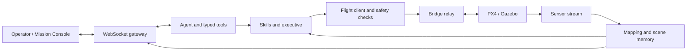

# Maverick

**Natural-language missions for an indoor drone, built and evaluated in simulation.**

Maverick connects a tool-calling agent to spatial mapping, scene memory and drone navigation. An operator can ask it to explore an apartment, go to a room or search for an object. A browser console shows the camera, voxel map, planned path and agent conversation.

The project combines **Python · ROS 2 Jazzy · PX4 SITL · Gazebo Harmonic · TypeScript · three.js · Docker**.

> Active prototype. Typed missions and simulation tooling are implemented; voice interaction and real-world flight remain development goals. Simulation results are not hardware validation.

## What is here

| Component | Implementation |
| --- | --- |
| Flight and transport | PX4 offboard mission client, setpoint safety checks, bridge relay and simulated Wi-Fi faults |
| Mapping and navigation | Depth-based voxel mapping, frontier exploration, grid planning and room navigation |
| Scene memory | Room/object scene graph, queries and object-search skills |
| Agent | Typed skill tools, cancellable mission loop, scripted and cloud backends |
| Mission Console | Camera, 3D map, room/object labels, paths, transcript and photo cards |
| Evaluation | Generated apartments, separate scoring referee, seed ledger and repeatable scenario runners |
| Fast tuning | `kinsim`: real stack modules in a kinematic simulator, with calibration/reference data |

The agent requests skills; it does not issue flight setpoints. Flight-critical control stays on PX4. The bridge and host are separated from the referee's ground-truth network. See the [architecture study](docs/architecture-study.md) and [simulation plan](docs/simulation-plan.md) for the design and its assumptions.



## Try the console first

The console includes a **scripted mock demonstration**. It needs Node.js 22 and npm, but no GPU, ROS installation or API key. Its camera and mission events are synthetic; use it to explore the interface.

```sh
git clone git@github.com:desboisGIT/Maverick.git
cd Maverick/console
npm ci
npm run mock
```

In a second terminal, from `Maverick/console`:

```sh
npm run dev
```

Open **http://localhost:5173**. The mock explores a generated apartment and searches the kitchen for bananas. The director menu can remove the object or simulate a connection loss. See the [console guide](console/README.md) for Docker instructions and gateway options.

## Run the simulation stack

The development setup uses a Linux host, Docker Engine with Compose, an NVIDIA GPU with the NVIDIA Container Toolkit, and `just`. ROS 2, Gazebo and PX4 run inside Ubuntu 24.04 containers. The [host setup script](scripts/setup-host.sh) targets Ubuntu 26.04; review it before using it to install system dependencies. Log out and back in after setup if Docker group membership changed.

From the repository root:

```sh
just setup-check
just build
just up
just hover
just down
```

The first image build is substantial. `just up` builds the ROS workspace and starts the simulator, bridge, host and referee; `just hover` runs a scripted hover trial. GUI runs require a working display; headless runs use the default `just up`.

For a typed mission using the scripted agent backend:

```sh
just live-s4 --seed 12 --backend scripted
```

This runner starts its own simulation stack; stop an existing stack first. Run the console separately and connect to the gateway specified by the runner. Cloud backends are optional; see [agent configuration and mission stages](docs/s4-plan.md). Keep API keys in the ignored `docker/.env.secrets` file.

## Evaluate and inspect

```sh
just test-unit
just lint
just test-failsafe --runs-per-case 3 --seed 1
just test-s3 --scenario explore --seeds 20 --budget 360
just kinsim --scenario explore --seeds 20-29 --jobs 4
```

Unit tests and lint run in Docker. Scenario runners write structured results and diagnostic logs under `runs/`. The [seed ledger](docs/seed-ledger.md) separates tuning layouts from held-out evaluation layouts. Do not use held-out layouts for debugging or parameter tuning.

`kinsim` accelerates tuning by running the real mapping, memory, skill and flight-mission modules without Gazebo. Its calibration, agreement measurements and limitations are documented in the [kinsim report](docs/kinsim.md). Confirm changes in Gazebo; kinsim numbers are not S3/S4 exit-test results.

For console checks, run `npm run typecheck` and `npm run build` from `console/`. With the mock gateway running, `npm run smoke` validates its event stream. The current [CI workflow](.github/workflows/ci.yml) runs Python lint and unit tests; full Gazebo scenarios are separate.

## Current limits

- Closed-loop simulation development uses simulated motion capture for localisation. Results using it must be labelled accordingly.
- Semantic perception in the current simulation uses segmentation-based detections with a noise model. This does not establish performance from a real RGB camera.
- Voice input, complete speech output and later perception/hardware stages are planned; the mock console is not evidence that these work on a drone.
- Safety checks, network-fault tests and simulated failsafes support development. Real flight requires separate hardware integration and validation.

## Explore the code

| Path | Contents |
| --- | --- |
| [`ros2_ws/src/`](ros2_ws/src/) | Agent, skills, flight, mapping, memory, gateway and ROS interfaces |
| [`console/`](console/) | Mission Console and mock gateway |
| [`sim/`](sim/) | World generation, sensor drivers, referee and kinsim |
| [`docker/`](docker/) | Container topology, runtime configuration and entrypoints |
| [`scripts/`](scripts/) | Host setup and simulation utilities |
| [`docs/`](docs/) | Design decisions, stage reports and evaluation methodology |

Start with the [host-stack guide](docs/s3-host-stack.md), [agent plan](docs/s4-plan.md), [gateway protocol](docs/gateway-events.md) or [kinsim report](docs/kinsim.md).

## License

[MIT](LICENSE).
